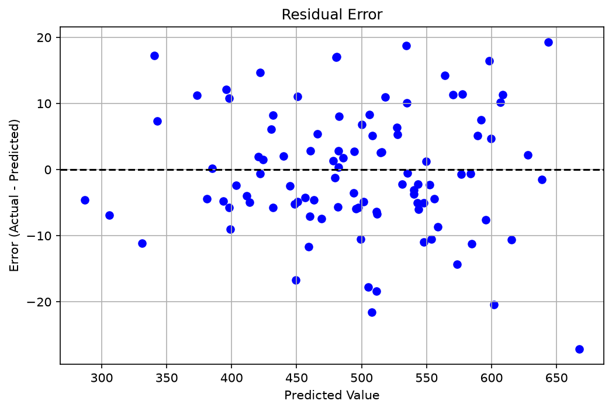

# E-Commerce Customer Analytics

## Project Overview

This project explores how customer data can be analyzed using Python and machine learning to understand purchasing behavior and support business decisions.

The long-term goal is to build a reusable customer analytics workflow, extending from exploratory data analysis to customer segmentation and predictive modeling.

## Version 0.1 – Exploratory Analysis & Regression

### Dataset

The initial dataset contains 500 customer records with information about:

- Average session length
- Time spent on the mobile application
- Time spent on the website
- Length of customer membership
- Yearly amount spent

**Dataset source:** [E-Commerce Dataset – Kaggle](https://www.kaggle.com/datasets/abrahamanderson/ecommerce)

**License:** Not specified / unknown on the dataset page.

**Note:** The dataset is not included in this repository because redistribution rights could not be verified.

### Methodology

**1. Data inspection**

Checked data structure, data types, missing values, duplicate records and descriptive statistics.

**2. Correlation analysis**

Calculated Pearson correlations to examine linear relationships between customer behavior and yearly spending.

**3. Linear regression**

Trained a multiple linear regression model using four customer behavior features to predict yearly spending.

The data was divided into 80% training and 20% testing observations.

**4. Model evaluation**

Evaluated predictive performance using R², MAE and MSE. Residual analysis was performed to identify potential systematic prediction errors.

### Results

| Metric | Result |
|---|---:|
| R² | 0.9855 |
| MAE | 7.51 |
| MSE | 87.46 |

The model achieved strong predictive performance on the held-out test set.

Customer membership duration showed the strongest positive correlation with yearly spending, followed by app usage.

Website usage showed almost no linear correlation with yearly spending.

### Residual Analysis



The residual plot shows no obvious systematic pattern across predicted spending values.

### Business Interpretation and Limitations

Although the model predicts yearly spending accurately on this dataset, high predictive performance alone does not demonstrate business value.

In particular, the available data does not include individual transactions, purchase frequency, discount usage, profit margins or observed customer churn.

Therefore, the results should be interpreted as associations rather than evidence of causal relationships or validated retention strategies.

## Experimental Work

An initial K-Means customer segmentation experiment is preserved in `experiments/`.

The experiment explores customer similarities but does not establish validated churn-risk segments.

## Future Development

- Introduce a transaction-level dataset
- Analyze purchasing frequency, recency and monetary value
- Explore behavioral customer segmentation
- Develop and evaluate customer-retention prediction models
- Investigate profit-oriented retention strategies

## Technologies

Python, Pandas, NumPy, scikit-learn, Matplotlib

## Running the Project

Create and activate a Python virtual environment, install the required dependencies, and run the main script.

```powershell
python -m venv .venv
.\.venv\Scripts\Activate.ps1
python -m pip install -r requirements.txt
python main.py
```

The required dataset must be available at `data/ecommerce.csv`.

## Status

**Work in progress** — Initial exploratory analysis and linear regression completed. Further development is planned.